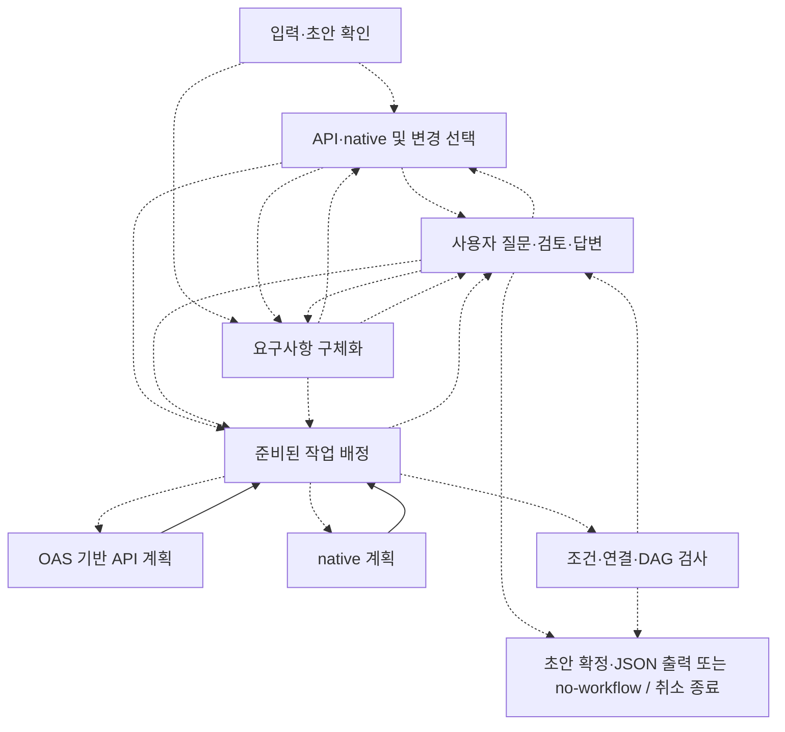
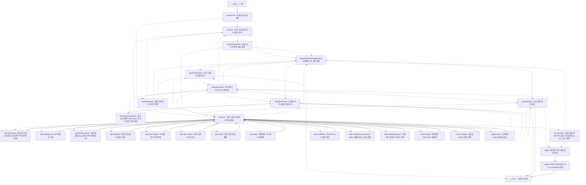
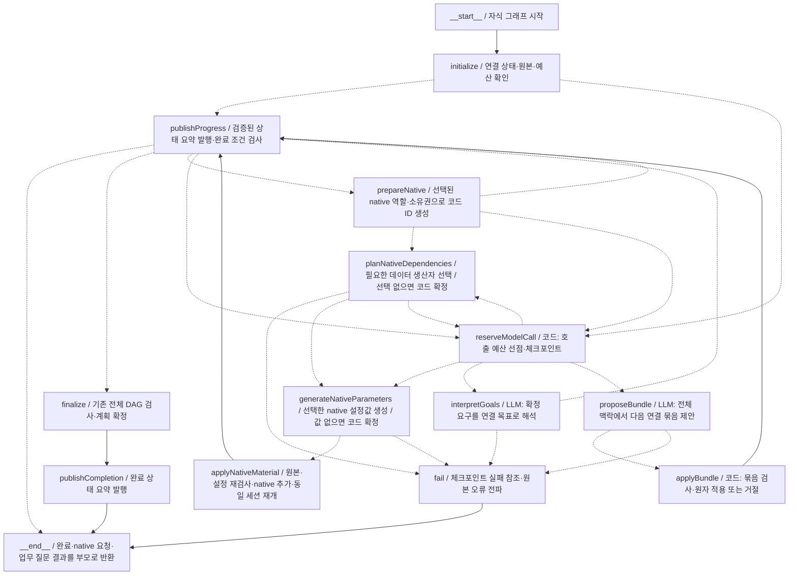

# 현재 대화형 워크플로우 설계 그래프

이 그래프는 사용자의 대화로 n8n 워크플로우를 만드는 LangGraph입니다. 최종 결과물인 n8n 실행 그래프와는 다릅니다. 구조도이며, 실제 실행 로그나 모든 기능의 검증 완료를 뜻하지 않습니다.

현재 작업(2026-10-25): 소스 b741f3d와 같은 태그, 세 npm 0.3.16·공개 다운로드 무결성·GitHub Release를 확인했습니다. 자동 연결 예시의 실모델 6회·거절 0회, native 1개·세 연결 묶음, 격리 n8n 4회·20건 로컬 요청 결과와 앞선 실패를 보존합니다. 릴리스 후보는 타입·lint·포맷·원본 OAS 56건·엔진/런타임 21개 묶음·독립 설치를 통과했습니다. 단위 1365/1366·기존 Ajv 1건과 보안 High 5를 유지하며 자동 게이트는 차단 상태입니다. 호스트는 공개 0.3.16을 설치하고 자동 계획·native 추가·업무 질문 checkpoint·SSE journal을 연결했습니다. 실제 모델과 브라우저의 짧은 질의는 API 5개·응답 수집 native·SDK JSON 생성과 복원을 완료했고 연결 프레임 0→5→5개를 기록했습니다. 같은 재료의 실제 모델 비교는 단일 호출 3/3·증분 2/3이며 증분 목표 검사 실패 1건의 세부 원인은 미확인입니다. 넓은 질의는 구체화에서 시간 초과했습니다. 호스트의 취소 전달 결함 수정 후 실제 60초 전송 종료를 확인했지만 구체화 지연은 해결하지 않았습니다. 전체 호스트 103개 파일·508개 테스트·타입·lint·포맷·빌드는 통과했습니다. 대규모 품질·계획 중 실제 렌더 계측은 남았고 정확도·속도 개선을 주장하지 않습니다. 기존 서버·의도한 JSON 시나리오를 유지했으며 회사 push·Cloud 배포는 하지 않았습니다.

공개 0.3.12의 세 턴 승인·네 번째 기술 질문과 실패 기록은 보존했습니다. 새 공개 0.3.13의 원본 OAS 두 개·네 턴 화면 대화에서는 API 다섯 개 → 결과 묶기 → 숫자 0 검사 다섯 개의 SDK JSON을 생성했습니다. 기존 API 요청값·OAS 계약·비교 조건은 유지했지만 집계 필드 이름과 응답 선택 범위가 바뀌어 출력 형태 보존은 통과로 세지 않습니다. 모델 HTTP 200과 의미 정확도는 구분합니다. 대기 여섯 지점의 승인 JSON 보존, 다운로드 일치와 새로고침 복원을 확인했으며 자동 재시도·업무 API·이 화면 결과의 n8n 엔진 실행은 없습니다. 한 대화의 관측 결과이며 넓은 품질·동적 대상·장기 스트리밍 검증은 미완료입니다. 기존 Ajv 실패·큰 JS 번들도 남습니다. 이 도식은 30개 노드·68개 경로의 참고 LangGraph이며 Qoopilot 실행 로그나 생성된 n8n 그래프와는 다릅니다.

## 단계 요약

같은 책임의 노드를 묶었습니다. 화살표는 실제 등록 경로를 그룹 단위로 합친 것이며, 그룹 내부 경로는 아래 전체 그래프에 있습니다. 점선은 조건에 따라 선택하는 경로입니다. API·native 작업은 준비 상태에 따라 배정하며 둘 다 항상 필요한 것은 아닙니다.

## 전체 등록 경로

실제 노드 30개(시작·종료 포함), 등록 경로 68개.

## 자동 연결 참고 자식 그래프 — 호스트 통합 검사 진행

실제 컴파일한 독립 예시의 노드 15개(시작·종료 포함), 경로 28개입니다. 위 대화 그래프에 연결된 경로나 별도 호스트 구현의 전체 구조가 아닙니다. 기술적 제안 거절은 예산 내에서 자동 반복합니다. nativeAugmentation을 명시하면 선택된 native의 설정·검증·추가 후 같은 세션을 이어갑니다. 옵션을 생략하면 native 요청을 부모로 반환하며 실제 업무 질문과 구분합니다. 호스트의 실제 모델→계획기→SSE 기록과 최종 화면·복원을 확인했습니다. 중간 프레임의 실제 렌더 시각과 대규모 품질 검사는 남았습니다.

## 갱신

`npm run graph:update`가 현재 소스를 빌드하고 실제 `createWorkflowDraftConversationGraph().getGraphAsync()`에서 이 문서를 다시 만듭니다. 모델·실서비스는 호출하지 않습니다. 이후 작업을 마칠 때 구조·현재 보강 안내를 갱신합니다. 상시 실행하는 감시 프로세스는 없습니다.

일반 회귀 검사에서도 현재 구조와 이 문서가 일치하는지 확인합니다. 새 노드에 한글 설명이 없거나 문서가 오래되면 실패합니다. 진행 상태 설명은 확인한 결과에 맞춰 갱신하며 노드 존재를 기능 완료로 표시하지 않습니다.

[실제 그래프 등록 코드](../examples/langgraph-workflow/src/graph/create-workflow-draft-conversation-graph.ts) · [현재 구현·검증 기록](conversational-oss-implementation.md)

구조 지문: `95df9615efd1244a6c95e850134323bea328e9ac72137e6eedbd3f4d76c4619e`
