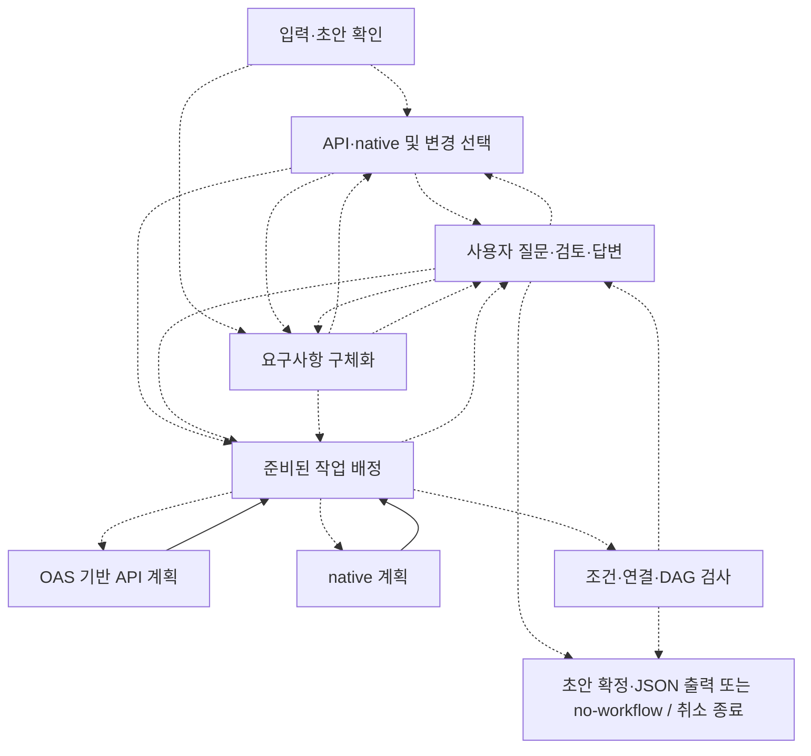
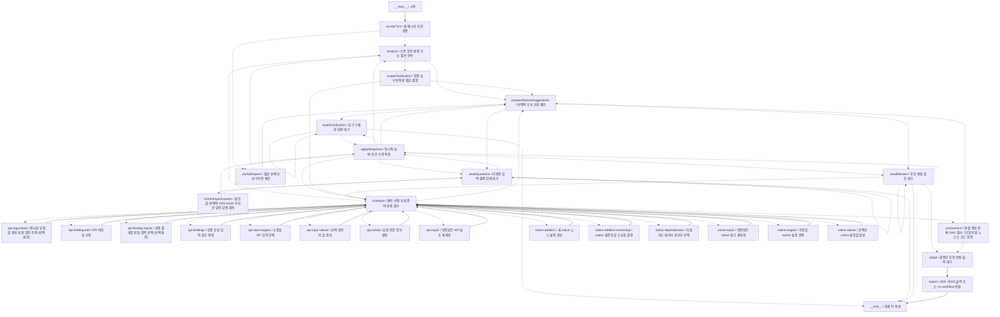

# 현재 대화형 워크플로우 설계 그래프

이 그래프는 사용자의 대화로 n8n 워크플로우를 만드는 LangGraph입니다. 최종 결과물인 n8n 실행 그래프와는 다릅니다. 구조도이며, 실제 실행 로그나 모든 기능의 검증 완료를 뜻하지 않습니다.

현재 작업: 기존 API 입력 편집 중 미확정 질문에도 자연어 답변을 연결했습니다. Core가 실제 미확정 대상·원본 OAS 계약에서 질문을 만들고 공통 추출 한 호출의 원문 값/enum 후보를 재검사합니다. 최초 모델 제안·기존 초안·계획과 부분 답변 기록을 보존하며 OAS 원본 버전과 정규화 스키마의 방언을 구분합니다. 실제 모델 첫 실행은 교체 질문을 삭제로 오해해 실패했고 원본을 보존했습니다. 공통 의미 설명 보강 뒤 동일 질의는 4회 모두 HTTP 200·답변 후 추출 1회로 NEW를 복사했고 격리 n8n 실행도 성공했습니다. 승인된 0.3.11 후보는 전체 1,239개 중 1,238개·원본 OAS 54개·격리 n8n 18개 검사군·독립 설치·타입·lint·포맷·빌드·세 배포 파일 검사와 감사 0건을 확인했습니다. 기존 Ajv 실패 1개는 유지합니다. 소스 원격 선반영과 npm 게시·Qoopilot 적용은 별도 확인해야 하며 제품은 아직 공개 0.3.10입니다. 중첩/동적 대상 전체·일회성 API·화면 연결·넓은 품질은 남았습니다. 도식 30개 노드·68개 경로는 유지합니다.

## 단계 요약

같은 책임의 노드를 묶었습니다. 화살표는 실제 등록 경로를 그룹 단위로 합친 것이며, 그룹 내부 경로는 아래 전체 그래프에 있습니다. 점선은 조건에 따라 선택하는 경로입니다. API·native 작업은 준비 상태에 따라 배정하며 둘 다 항상 필요한 것은 아닙니다.

## 전체 등록 경로

실제 노드 30개(시작·종료 포함), 등록 경로 68개.

## 갱신

`npm run graph:update`가 현재 소스를 빌드하고 실제 `createWorkflowDraftConversationGraph().getGraphAsync()`에서 이 문서를 다시 만듭니다. 모델·실서비스는 호출하지 않습니다. 이후 작업을 마칠 때 구조·현재 보강 안내를 갱신합니다. 상시 실행하는 감시 프로세스는 없습니다.

일반 회귀 검사에서도 현재 구조와 이 문서가 일치하는지 확인합니다. 새 노드에 한글 설명이 없거나 문서가 오래되면 실패합니다. 진행 상태 설명은 확인한 결과에 맞춰 갱신하며 노드 존재를 기능 완료로 표시하지 않습니다.

[실제 그래프 등록 코드](../examples/langgraph-workflow/src/graph/create-workflow-draft-conversation-graph.ts) · [현재 구현·검증 기록](conversational-oss-implementation.md)

구조 지문: `95df9615efd1244a6c95e850134323bea328e9ac72137e6eedbd3f4d76c4619e`
