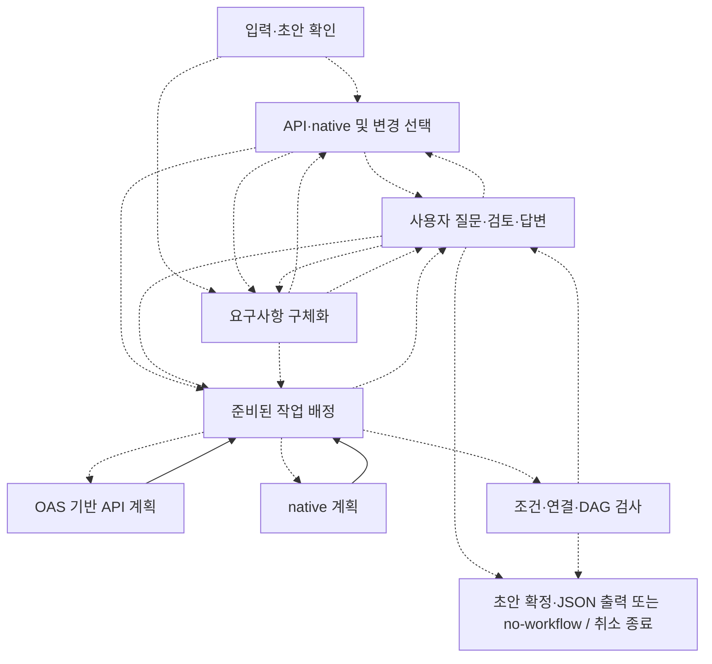
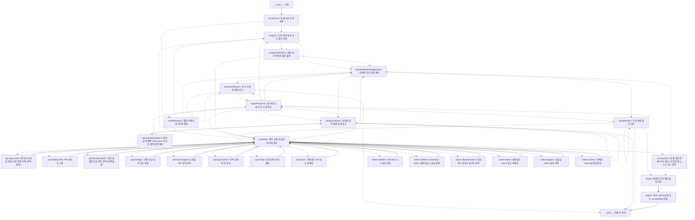
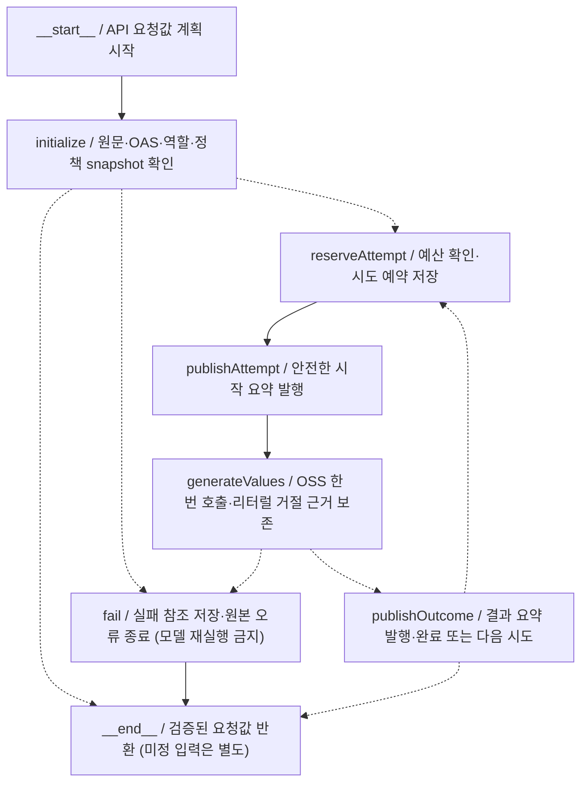
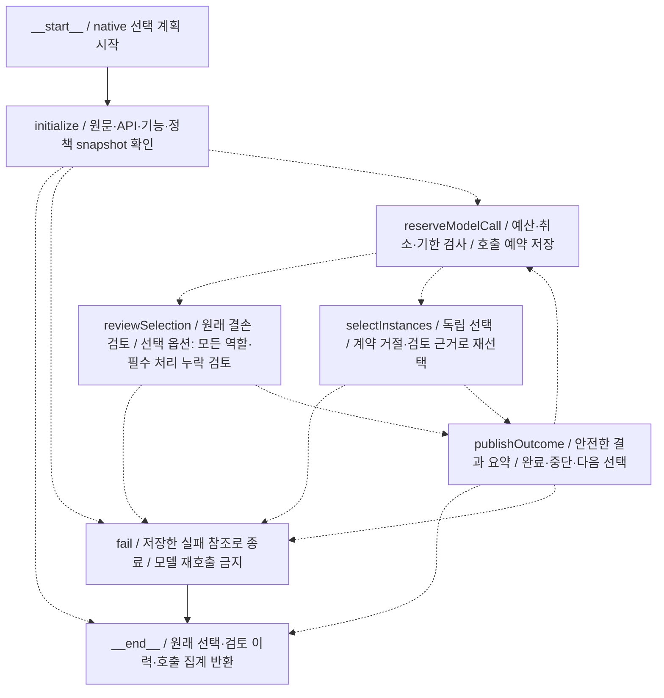

# 현재 대화형 워크플로우 설계 그래프

현재 후보 검증(2026-10-27): 전체 1793/1794·기존 Ajv 특수 키 한 실패·skip/cancel 0, 집중 76건과 실제 LangChain 로컬 HTTP의 표시 오류 분리를 확인했습니다. 원문 03의 새 OSS 직접 호출은 업무 개요→API 10개→수집 3개와 Merge 1개→전체 역할 검토를 4모델 호출·110.207초에 통과했고 불필요한 비교 질문은 추가되지 않았습니다. 첫 하니스는 호출 ID 할당 누락으로 중단됐으며 원본을 보존하고 두 번째는 처음부터 새로 실행했습니다. 이는 JSON·격리 n8n·화면 종단 성공이 아니며 0.4.2 버전 후보의 후속 릴리스 검증은 진행 중입니다.

현재 goal(2026-10-27, 0.4.2 공개 게시·제품 연결 중): API 선택·본문 형식·요청값·native 선택·생산자·설정의 표시용 이유를 실행 검사와 분리했습니다. 실제 값·타입·입력 소유권·출처·DAG 검사는 유지합니다. planWorkflowIntent는 구체 API/native 선택 전 업무 역할을 필수·조건부·제외로 구분하고 분기·집계 의도를 보관하며 의미 정확성의 코드 증명은 아닙니다. 소스 26cf8fe·같은 태그·세 npm 다운로드 무결성·게시된 GitHub Release를 확인했습니다. 제품은 공개 0.4.2를 설치하고 준비 단계의 개요와 전체 native 검토를 연결했으며 집중 38건을 통과했습니다. 실제 제품 등록은 45노드·109경로로 갱신했고 전체 verify는 진행 중입니다. 원문 03의 새 종단 생성·엔진·화면과 원래 다섯 쌍 평가는 남습니다. 아래 topology는 실제 등록에서 가져온 OSS 참조 대화 그래프이며 제품 topology와 구분합니다.

최신 수정(2026-10-27, 로컬·미배포): 목표 검토는 모델이 원문을 복사하지 않고 코드가 fact ID로 원문을 첨부합니다. 연결·목표 검토의 표시용 설명 실패는 실행 검사와 분리하고, 명시적 구현 계약이 생산자 선택만으로 설정 전체를 확정하는 native는 추가 값 생성 호출을 생략합니다. 재료 복구의 미사용 호출 예약은 정산하며 제품의 독립 요청값 생성은 최대 4개씩 처리하고 재개 전 전체 원본 지문을 확인합니다. 일반 화면의 공개 진행 건수를 표시합니다. 최종 OSS 단위 1780/1781·기존 Ajv 한 실패·skip/cancel 0, 제품 verify 120파일/647테스트·빌드·16경로, 격리 n8n 목표 검토 포함 2실행·로컬 요청 10건을 확인했습니다. 설명 없는 유효 연결도 SDK JSON으로 컴파일했습니다. 실제 모델·원문 다섯 쌍·브라우저 전체 평가는 새로 하지 않았습니다. API/native 선택·바인딩의 기존 설명 필수 경로와 native 검토의 모델 원문 복사는 남아 있으며 공백 차이 거절도 재현했습니다. 아래 실제 노드·경로와 공개 0.4.1·기존 서버·회사 원격·Cloud는 유지합니다.

추가 확인: 같은 원문을 처음부터 계획한 새 후보 실행은 native 선택 모델의 60초 요청 제한에서 중단됐으며 중간 계획을 대신 넣지 않았습니다. 앞선 생성물의 두 번째 격리 엔진 실행은 응답 10개와 최종 Merge 세 item의 원본 동일성을 확인했습니다. 단계 고정 검사와 전체 신규 생성의 실패를 같은 성공 수치로 합산하지 않습니다.

최신 작업(2026-10-27, 실제 예시의 연결 후보 계약·미배포): 원문 예시 03은 공개 0.4.1에서 제외한 업무를 native 결손으로 판단해 중단했습니다. 호스트가 native 선택·검토를 기존 planning 모델에 배정한 뒤 같은 원문·10개 API로 두 독립 모드 모두 연결 단계에 도달했습니다. 단일 방식은 모델의 긴 ID 오기, 증분은 원문과 다른 검토 인용에서 거절됐습니다. 단일 연결 출력은 제공된 ID·포트만 후보로 제한하고 새 결손만 명시적 gapId 참조로 구분하도록 보강했습니다. 기존 실제 모델 재료를 보존한 후보 연결 1회가 13연결·SDK JSON을 만들었고 격리 n8n에서 로컬 GET 10건과 서비스별 3묶음을 실행했습니다. 이는 연결 단계 후보 검사이며 전체 신규 생성·다섯 쌍 품질·화면 검증이나 공개 업데이트 완료가 아닙니다. 업무 API는 호출하지 않았고 원본 예시의 enum 예시는 업무 사용자 승인과 구분합니다. 기존 Ajv 특수 키 제약, 증분 검토 인용 문제와 전체 0~7 범위는 남습니다. 아래 실제 LangGraph topology는 유지합니다.

최신 작업(2026-10-27, 소비자 실제 원인 단계 배정): 공개 0.4.1을 사용하는 호스트 증분 factory에 API 출처·바인딩·요청값과 native 생산자·설정의 실제 함수를 배정했습니다. 공개 Core가 도출한 후속 값 작업만 원문 출처로 생성하고 native 설정은 실제 생산자 계약 순서로 진행합니다. 성공한 결과는 LangGraph task에 지문과 함께 저장하며 실행 모델·함수는 저장하지 않습니다. 새 합성 9건에서 실제 부모의 원인 수정·7연결·SDK JSON, 원본 보존, 후속 실패 뒤 두 모델 결과 재사용과 변경된 지문 거절을 확인했습니다. 예약은 요청별 호출 상한이며 실제 HTTP 수가 아닙니다. 보수적 예약 비용과 새 미정 입력/native 설정의 질문 연결은 남습니다. 실제 제품 자식은 23노드·51경로이고 동적 task를 별도 고정 노드로 그리지 않습니다. 수용본 수정·복구 SSE/UI·일반 native·원문 다섯 쌍의 최종 모델/엔진/화면 검증은 미완료이며 기존 0/5·0/5를 유지합니다. 공개 설치 0.4.1·기본 단일 모드·고정 QA·기존 서버·회사 원격·Cloud와 전체 0~7단계는 유지합니다. 아래 OSS 참조 그래프 topology와 공개 패키지 소스는 바뀌지 않았습니다.

이전 작업(2026-10-27, 요청 범위·전체 native 선택 검토·미배포): 요청하지 않거나 제외한 작업의 결손을 not-required로 구분하고 원래 선택을 보존한 채 재선택합니다. reviewInstances: true를 명시하면 모든 선택 역할과 필수 처리 누락을 함께 검토하며 빈 선택도 건너뛰지 않습니다. 코드는 실제 ID·완전한 검토·원문 인용·출처·모드·예산·최신 검토 일치를 검사하고 준비 상태를 확정합니다. 모델의 의미 판단을 코드 증명으로 취급하지 않습니다. 원문 03의 detail 모델은 6호출/2재선택 예산에서 수렴하지 않았고, 같은 원문·10개 API의 planning 모델 대조는 선택·검토 2호출로 통과했습니다. 전체 워크플로우나 다섯 쌍 품질 통과는 아닙니다. 최종 단위는 1770/1771·기존 Ajv 한 실패·skip/cancel 0이며 타입/빌드/Lint/포맷·원본 OAS 59건·독립 strict 설치·기존 두 부모의 격리 엔진 회귀를 확인했습니다. 제품 공개 0.4.1·모델 기본값·기존 서버·회사 원격·Cloud는 유지하며 아래 실제 topology도 바뀌지 않았습니다. 전체 0~7 범위의 제품 복구·원자 채택·남은 native·최종 품질 검증은 진행 중입니다.

현재 작업(2026-10-27, 0.4.1 공개 게시·제품 통합): 최종 소스 0b1792c와 같은 주석 태그 v0.4.1을 원격에 먼저 반영했습니다. 세 npm 공개 다운로드와 검사본 SHA-512 일치, GitHub Release의 게시 상태·태그·노트를 확인했습니다. 최종 OSS 후보는 단위 1757/1758·기존 Ajv 한 실패, 원본 OAS 59건·격리 엔진 명령 33묶음·독립 strict 설치가 통과했으며 보안 High 5건은 남습니다. 제품은 공개 0.4.1과 API별 원문 목록을 task 입력·지문에 연결했습니다. native 선택·검토의 같은 요청 출력 계약 오류만 원본 그대로 checkpoint에 남겨 기존 예산 안에서 해당 단계를 다시 호출합니다. 전송·취소·출처 변경·실제 미지원·업무 질문은 자동 우회하지 않습니다. 제품 최종 117파일/616테스트·타입/Lint/포맷·빌드와 HTTP/SSE 합성 두 조건이 통과했습니다. 원문 다섯 쌍의 새 독립 평가는 여전히 단일 0/5·증분 0/5·연결 도달 0건이며 API 선택은 모두 기대 28종과 일치합니다. 업무 질문 2건·미지원 판단 7건·재선택 예산 1건을 구분하고, 제외된 업무를 결손으로 본 판단과 검토 계약의 요청 밖 분류 부재를 확인했습니다. 그 분류 보강은 아직 미구현입니다. 아래 실제 topology는 바뀌지 않았고 원인 재료 복구 dispatcher·원자 채택·남은 native·최종 엔진/화면 평가의 전체 0~7 범위는 미완료입니다. 회사 push·Cloud·기존 사용자 서버는 변경하지 않았습니다.

현재 작업(2026-10-27, enum 원문 출처·미배포): API 값 생성의 원문 목록을 enum 의도 단계까지 전달합니다. 각 메시지의 인용 후보·UTF-16 위치는 따로 유지하고 JSON 포장이나 이어 붙인 문자열에서 값을 추출하지 않습니다. 한 메시지의 ID는 코드 소유이고 여러 메시지에서는 모델이 제공된 ID·인용 위치·해당 OAS 후보만 선택합니다. 코드는 원본 enum 값을 타입 그대로 복사하고 메시지 ID를 기록·재검증합니다. 명시적 원문이 모두 비어 있으면 모델 호출 없이 입력 미정으로 남으며 두 번째 enum 호출 중 원문/복구 입력 변경도 거절합니다. 새 18건 포함 전체 1747/1748·기존 Ajv 한 실패·skip/cancel 0, 집중 65건·원본 OAS 4파일/59건·타입/빌드/Lint/포맷·그래프 5건·독립 설치를 확인했습니다. SDK HTTP 검사는 기존 네 조건과 메시지 두 조건이며 실제 모델의 좁은 입력 검사에서는 최초 계약 거절·같은 원문과 검증 피드백을 사용한 명시적 예산 내 1회 재계획·OAS enum 값 복사를 확인했습니다. 앞선 직접 실패와 측정 하니스 실패도 보존했습니다. 인용 의미의 충분함·원문 다섯 쌍 품질·업무 API·엔진 검증을 대신하지 않습니다. 아래 실제 topology는 유지하고 제품 복구 dispatcher·전체 원문 다섯 쌍 품질 평가는 아직 완료하지 않았습니다. Qoopilot 공개 0.4.0·잠금·기존 서버·회사 원격·Cloud와 원래 0~7 범위를 유지합니다.

현재 작업(2026-10-27, 원문 출처 채널·미배포): API 값 생성이 계획 문맥 scenario와 실제 literalSourceMessages를 분리해 받습니다. 한 원문의 ID는 코드가 붙이고 여러 원문에서는 제공된 ID만 모델이 선택합니다. 기존 완전 인용·타입·전체 값 검사와 JSON 문자열 보호는 유지합니다. materialRepair.literalContext는 별도 원문 문맥을 명시적으로 고정하면서 원래 API·역할·OAS·바인딩 검사를 유지합니다. 예제 API 재계획 자식은 runtime 계약을 checkpoint에 넣지 않고 검증 설명·지문을 저장하며 실제 복구 입력을 호출에 전달합니다. 새 회귀 20건 포함 전체 1729/1730·기존 Ajv 한 실패·skip/cancel 0, 집중 46건·OAS 4파일/59건·타입/빌드/Lint/포맷·그래프 5건·독립 설치를 확인했습니다. SDK 로컬 HTTP의 실제 전송 스키마도 검사했습니다. 실제 모델·업무 API 호출은 없으며 아래 실제 topology와 Qoopilot 공개 0.4.0·잠금·기존 서버·회사 원격·Cloud는 유지합니다. 다중 메시지 enum 의도 추출·제품 복구 dispatcher·원문 다섯 쌍 독립 평가와 전체 0~7 범위는 미완료입니다.

이 그래프는 사용자의 대화로 n8n 워크플로우를 만드는 LangGraph입니다. 최종 결과물인 n8n 실행 그래프와는 다릅니다. 구조도이며, 실제 실행 로그나 모든 기능의 검증 완료를 뜻하지 않습니다.

현재 작업(2026-10-27, 기존 native 복구·미배포): 기존 ID·기능·실행 입력 소유권을 고정한 출처 선택과 설정 생성 함수를 분리했습니다. Core는 요청된 행만 모델 출력에 두고 보존한 API/native 참조까지 합쳐 순환을 검사합니다. 완료 후보를 순서대로 재생해 실제 새 출력 계약을 전달하고 미완료 생산자의 옛 출력은 쓰지 않습니다. 설정만 고치는 적용의 생산자 변경을 차단하며 실제 계약을 다시 연결합니다. 값/질문 schema·생산자 추출은 공유하고 API 요청 계약은 모델에 복제하지 않습니다. 원래 거절 출력·복구 지문·원인은 전용 오류에 보존합니다. native 새 17건과 API 원문 형식 경계 1건 포함 전체 1709/1710·기존 Ajv 한 실패·skip/cancel 0, OAS 4파일/59건·타입·빌드·Lint·포맷·독립 설치를 확인했습니다. 고정 합성 n8n 2.37.10 전후 두 조건을 총 네 번 실행해 잘못된 생산자의 빈 결과와 수정 후 원래 값/타입 보존을 확인했습니다. 초기 자료/하니스의 계약·등록부 혼동은 수정·재검사했고 실제 모델·업무 API 호출은 0회입니다. JSON 문자열 내부 인용을 문자열 추가로 해결하려던 초안은 채택하지 않았으며 원문 메시지·답변의 명시적 출처 채널이 남습니다. 아래 topology는 그대로이고 제품 복구 dispatcher는 미연결입니다. 공개 0.4.0·제품 잠금·기존 서버·회사 원격·Cloud·전체 0~7 범위와 원문 다섯 쌍의 기존 품질 결과를 유지합니다.

현재 작업(2026-10-27, API 복구 입력·미배포): 목표 충돌의 원인인 API 바인딩/요청값 계획에 별도 materialRepair 입력을 추가했습니다. Core는 원본·대상·OAS·역할·생산자·검증된 의존 작업을 검사하고 모델은 원래 시나리오와 분리된 근거만 받습니다. 값 생성은 원문 인용 검사를 사용하며 복구 이유나 이전 출력에서 값을 복사하지 않습니다. 원본/전체 복구 요청의 호출 중 변경과 다른 복구의 거절 재사용도 차단합니다. 숨은 재시도·자동 채택·새 기본값은 없습니다. 집중 54건·원본 OAS 4파일/59건·전체 1691/1692와 기존 Ajv 한 실패·skip/cancel 0, strict 타입·빌드·Lint·포맷·독립 3패키지 설치를 확인했습니다. 초기 검증의 빌드/테스트 중첩·OAS 경로 누락·테스트 Lint 오류는 보존하고 올바른 경로로 재검사했습니다. 실제 SDK의 로컬 HTTP 전송 검사이며 실제 모델·업무 API·엔진 호출은 0회입니다. 아래 실제 topology는 바꾸지 않았고 native 원인 단계와 제품의 원자 복구 dispatcher는 남습니다. 공개 세 패키지 0.4.0·Qoopilot 설치/기존 서버·회사 원격·Cloud는 유지하며 전체 0~7 범위와 원문 다섯 예제의 0/5·0/5 평가를 보존합니다.

최신 게시·설치(2026-10-27): 소스 532a1f4와 같은 v0.4.0 태그를 개인 원격에 먼저 반영했습니다. 세 npm 공개 다운로드는 검사본·해당 커밋의 재빌드본과 SHA-512가 같고 GitHub Release도 published 상태입니다. Qoopilot은 공개 0.4.0을 설치해 전체 verify 112파일·571테스트·strict 타입·Lint·포맷·빌드·16개 API 경로와 frozen-lockfile 재설치를 확인했습니다. 새 enum 기능 4종의 한국어 표시는 추가했지만 계층적 개요·독립 검토의 제품 조합이나 원문 다섯 시나리오의 새 모델/UI 품질 검사는 아닙니다. 아래의 게시 전·공개 0.3.18 안내는 이전 검사 시점의 기록입니다. 전체 0~7 목표는 계속 진행하며 회사 저장소 commit/push·Cloud·기존 서버 재시작은 하지 않았습니다. 기존 Ajv 한 실패·같은 SDK Zod 3 보안 High 5와 큰 제품 번들 경고를 남깁니다. 실제 OSS 예제 topology는 바꾸지 않았습니다.

릴리스 검증(2026-10-27, 0.4.0·게시 전): 시작·종료 지점을 모델 출력 없이 자동 지정하던 계획기를 수정했습니다. 모델은 실제 시작/종료 의도를 선택하고 코드는 유일한 선언 포트만 해석하며 전체 그래프·개요 범위·revision 검사를 유지합니다. 집중 110건, 수정 후 전체 1678/1679·기존 Ajv 한 실패·skip/cancel 0, 원본 OAS 4파일/59건, 격리 엔진 명령 33개와 독립 패키지 설치·strict 타입 검사가 통과했습니다. 최초 Lint/OAS 대역 실패는 기록을 보존하고 명시적 계약으로 수정한 뒤 재검사했습니다. 보안 High 5는 이전 SDK Zod 3 의존 기록과 같으며 clean audit으로 표시하지 않습니다. 필수 planningParametersSchema와 추적 출력 타입 변경으로 후보는 0.4.0입니다. 소스 원격 선반영·일치 태그·npm·GitHub Release·제품 공개 설치를 순서대로 진행하며 이 안내는 게시 완료의 근거가 아닙니다. Qoopilot 공개 0.3.18·사용자 서버·Cloud와 아래 실제 topology는 유지합니다. 계층적 제품 통합·남은 native·원문 다섯 예제 독립 품질 평가를 포함한 전체 목표는 미완료입니다.

제품 관찰 수명(2026-10-27, 로컬 미배포): Qoopilot의 명령 전송과 SDK 관찰을 분리했습니다. 실행 중에만 새 관찰자를 연결하고 대기/종료 상태는 검증된 서버 snapshot으로 표시합니다. snapshot 순번 이후의 재생과 명령 승인/focus의 재조회를 사용하며 구독 해제를 서버 취소로 바꾸지 않습니다. 직접 HTTP와 StrictMode의 실제 hook에서 해제 뒤 같은 run 유지·복원·명시적 취소 종료를 확인했고 종료된 작업 7개 탭의 SSE는 0개였습니다. 검증용 개발 프록시의 연결 잔류 원인은 미확정입니다. 일반적인 지연 해결·원문 다섯 예제의 새 생성 성공으로 세지 않습니다. 새 OSS의 검증 후 소스 선반영·일치 태그·npm·GitHub Release·로컬 적용은 승인받았지만 아직 게시 전입니다. 실제 모델/업무 API/엔진 호출은 없고 공개 0.3.18·기존 서버·Cloud·아래 topology는 유지합니다. 계층적 제품 통합·남은 native·다섯 원문 독립 평가·릴리스의 전체 0~7 범위는 진행 중입니다.

현재 작업(2026-10-27, 로컬 미배포): native 처리 결과의 수집을 공식 Aggregate로 연결했습니다. CollectNativeOutputValues는 실제 생산자 ID와 원본 포인터만 선택하며 API 수집과 검사·SDK 컴파일을 공유합니다. 자체 집계 엔진·형변환·중복 제거·배열 펼치기는 없고 원본 타입·순서·모든 pairedItem 이력을 유지합니다. 빈 입력은 가짜 결과를 만들지 않으며 부재·계약 위반은 Aggregate 전에 거절합니다. 집중 48건·원본 OAS 59건·전체 OSS 1674/1675·기존 Ajv 한 실패·skip/cancel 0, strict 타입·빌드·Lint·포맷을 확인했습니다. 합성 격리 n8n 9조건·후속 로컬 REST 4요청이 정상/차단 기대와 일치합니다. 실제 모델·업무 API 호출은 0회이며 원문 다섯 예제의 새 전체 평가·제품 UI 적용은 아닙니다. 공개 0.3.18·lockfile·기존 서버·Cloud와 실제 topology는 유지합니다. 선택 검토·계층적 제품 통합·분류/페이지·다섯 원문 독립 품질 평가·승인 릴리스의 전체 0~7 범위는 진행 중입니다.

최종 소스 검증(2026-10-27): 집중 81건·원본 OAS 4파일 57건·전체 OSS 1661/1662·기존 Ajv 특수 키 한 실패·skip/cancel 0입니다. strict 타입·빌드·Lint·포맷과 실제 등록 그래프 일치를 확인했습니다. 별도 격리 n8n의 native 비교 7조건과 그룹 선택/실행 입력 6조건·로컬 요청 9건이 정상/차단 기대와 일치했습니다. 합성 엔진 실행을 원문 다섯 예제의 새 전체 생성 성공으로 합산하지 않습니다. 실제 다섯 쌍 재평가의 0/5·0/5는 아래에 구분하며 전체 목표는 진행 중입니다.

후속 작업과 실제 평가(2026-10-27, 로컬 미배포): 원문 다섯 쌍의 새 독립 생성은 단일 0/5·증분 0/5이며 모두 연결 이전에 멈췄습니다. API 선택은 열 번 모두 같았고 9건은 native 결손 보고, 한 건은 모델 후보 schema를 실행 입력 검사로 옮기던 혼용 오류였습니다. 이 비교의 원본·소스 지문은 보존했으며 연결 알고리즘 실패나 속도 우위로 해석하지 않습니다. 이후 Core가 실행 capability와 모델 후보 schema를 분리하고, 기존 참조 계약상 계획 시 빈 설정이 불가능하면 전체 runtime 소유권을 후보에서 제외했습니다. 그룹 키 같은 부분 입력은 유지하며 원본 출력은 고쳐 채택하지 않습니다. 선택·설정·후속 native 설정 회귀와 실제 custom 검사/변환 거절은 유지합니다. 원본 실패 출력의 전체 입력 소유권은 별도 무변경 재생에서 올바르게 거절됐으며 새 모델 호출·성공 JSON으로 대체하지 않았습니다. Qoopilot 공개 0.3.18·기존 서버·Cloud는 그대로입니다. 계층적 제품 통합·나머지 native·전체 재평가/엔진/화면·승인 릴리스의 0~7 범위는 미완료입니다.

현재 작업(2026-10-27, 로컬 미배포): 기존 IF·assertion이 API 본문과 실제 native JSON을 구분해 비교하도록 공통 계약을 보강했습니다. 준비 완료된 생산자 ID와 해당 포인터만 모델 후보로 주며 미래 출력은 추측하지 않습니다. 새 native 기능군·업무 판정 기본값·비교 알고리즘은 추가하지 않았습니다. 격리 n8n에서 IF 표현식 오류가 false로 끝난 경우를 재현하고, 선택 값의 존재·연산 타입을 앞선 Code 단계에서 검사하도록 수정했습니다. 정상 false·원본 타입·paired-item 연결은 유지합니다. 단일/단계별 실제 LangChain의 로컬 HTTP 전송과 집중 회귀 30건, 전체 OSS 1660/1661·기존 Ajv 특수 키 한 실패·skip/cancel 0을 확인했습니다. 고정 합성 데이터의 격리 n8n 7조건은 정상/차단 기대와 일치하며 실제 모델·업무 API 호출은 0회입니다. 제품의 공개 0.3.18 설치·기존 서버·Cloud와 아래 실제 topology는 바꾸지 않았습니다. 계층적 제품 통합·나머지 native·원문 다섯 예제의 독립 평가·승인 릴리스 등 전체 0~7 범위는 남습니다.

소비자 진행 화면 보강(2026-10-27, 로컬 미배포): 기존 공개 0.3.18 함수로 실제 OAS 작업·검사된 native 설정·요청 준비 상태를 연결 전부터 표시합니다. 재료 단계는 포트·실행 간선·시작/종료 판정이 없고 연결 단계와 별도 표시 세션을 사용합니다. task에 먼저 저장한 이벤트의 동일 실행 재개·SSE 재생과 대기 상태 보존을 검사했습니다. 실제 제품 컴포넌트의 합성 검증에서 API 5개에서 native 포함 6개, 연결 0에서 3개·7개로 진행했고 새 탭의 콘솔 경고/오류는 없었습니다. 노드·간선을 같은 프레임에서 갱신하고 포트 변경 시 이전 측정값만 폐기한 뒤 공식 훅으로 다시 측정합니다. 실제 모델·업무 API·엔진·원문 다섯 예제의 성공 근거는 아니며 새 native 검토 자식이나 계층적 개요의 제품 적용도 아닙니다. 아래 OSS 예제 topology와 공개 설치·잠금 파일·기존 서버·Cloud는 유지합니다. 제품의 별도 등록 구조는 43노드·102경로이며 이 OSS 그림에 가상으로 합치지 않습니다.

해당 소비자 경로의 최종 집중 35건·전체 verify 109파일/550테스트·정적 검사·빌드·16개 API 경로 생성이 통과했습니다. 원본 등록에서 두 저장소의 그래프를 재생성했고 OSS 그래프 회귀 5건을 확인했습니다. 초기 전체 실행의 기존 TCP/enum 검사 시간 초과와 기존 번들 크기 경고는 별도 한계로 남깁니다. 검증 전용 HTTP 서버의 종료 지연은 완료 확인 뒤 연결을 닫도록 자원 해제를 수정했고 제품 서버나 테스트 제한은 바꾸지 않았습니다.

이번 작업(2026-10-27, 로컬 미배포): native 결손 검토·재선택을 예제의 독립 자식 그래프로 조합하고 두 생성 부모에 선택 옵션으로 연결했습니다. 추가 호출·재선택·기한을 명시적으로 제한하며 원래 선택·검토·반복 시도를 checkpoint에 보존합니다. 같은 제안에는 이전 검토를 재사용하고 실제 미지원·업무 판단은 우회하지 않습니다. 통신·observer 실패를 저장한 뒤 재개해도 모델을 다시 호출하지 않습니다. 아래 새 자식 그래프는 실제 등록에서 추출하며 Qoopilot 제품에 연결된 그래프로 표시하지 않습니다. 공개 0.3.18·기존 서버·Cloud와 다섯 원문 평가의 기존 결과는 유지합니다. 제품 SSE/UI·업무 HITL 라우팅과 원문 다섯 예제의 재생성·엔진 평가는 남습니다.

현재 보강(2026-10-27, 로컬 미배포): native 선택의 결손을 실제 미지원·설정·API 단계·연결 단계·업무 판단으로 독립 검토하는 OSS 함수와 명시적 재선택 feedback을 추가했습니다. 코드는 기존 gap 전체·실제 참조·원문 인용·선택 원본과 상태를 검사하며 원래 결손을 지우거나 검토를 실행 승인으로 바꾸지 않습니다. 추가 호출/예산/checkpoint는 호스트 소유입니다. 보존된 실제 모델 실패 두 건의 검토에서는 API 책임 오분류를 구분했지만 실제 미지원과 미정 업무도 남았습니다. 두 건은 다섯 예제 전체 재생성이나 Qoopilot 통합 성공이 아닙니다. 공개 0.3.18·사용자 서버·Cloud와 실제 topology를 유지하며 새 자동 검토 노드를 이 그림에 가상으로 추가하지 않습니다.

현재 작업(2026-10-27, 로컬 미배포): native JSON 출력의 원본 필드 선택을 공식 Edit Fields 표현식으로 연결했습니다. Core는 실제 생산자/포인터와 원본 타입을 검사하고 같은 schema 리소스를 필드마다 중복하지 않습니다. guard는 원본 계약과 선택 값의 실제 존재만 검사하며 여러 item을 합치거나 값을 보정하지 않습니다. 집중 56건과 격리 n8n 정상 2조건/차단 2조건·후속 로컬 요청 2건을 확인했습니다. 등록부는 16개·기본 계획 목록 15개입니다. 별도 실제 Chomsky 원문 다섯 예제 독립 비교는 단일 1/5·증분 0/5였고 9건이 연결 전 native 단계에서 중단됐습니다. 이 엔진 검사를 원문 예제의 성공으로 세지 않습니다. 파생 출력·분류·반복·계층적 제품 통합/SSE/UI·독립 품질 평가·승인 릴리스는 남습니다. 공개 0.3.18·lockfile·사용자 서버·Cloud는 유지합니다. 현재 topology의 노드·경로 수는 아래 실제 등록 그래프의 자동 집계를 따릅니다. 이전 보강 안내의 수치를 현재 집계로 사용하지 않습니다.

제품 화면 선택 상태(2026-10-27, 로컬 미배포): 실제 Canvas 컴포넌트에서 삭제된 노드의 선택 ID가 남는 문제를 재현하고, 선택 정리를 카메라/크기 측정 효과에서 실제 노드 목록 변경으로 옮겼습니다. 삭제 시 해제·복원 시 미선택·연결 추가 시 유지·재삭제를 격리 브라우저로 확인했고 Qoopilot 집중 9건·전체 verify 107파일/536테스트가 통과했습니다. 수정 전후 ResizeObserver 경고의 원인·영향 추적은 남습니다. 합성 미리보기 검사이며 전체 SSE·실제 모델·원문 다섯 예제 품질 완료는 아닙니다. 공식 SDK 설정의 모델 스키마 추출도 일부 비공개 보조 함수가 필요해 연결 작업이 남습니다. 새 기능/내부 SDK 우회 없이 기존 공개 0.3.18·사용자 서버·Cloud와 아래 소비자 topology 29노드·67경로를 유지합니다.

응답 필드 선택 계약(2026-10-27, 로컬 미배포): 공통 재료 캡처가 준비된 API 전용 계약을 결합하므로 단계별·일괄 native·전체 그래프 계획에서 실제 API ID와 그 OAS의 포인터 후보를 함께 제한합니다. 미래 native 출력은 미확정 상태로 남기고 결합 오류는 전파합니다. 두 LangChain 전송 경로의 잘못된 교차 참조 거절을 확인했으며 값·타입·이름 규칙·기존 SDK 컴파일러·15기능 등록부는 유지합니다. 고정 합성 OAS의 격리 n8n 정상 2조건·차단 2조건·로컬 요청 18건과 원본 예제 05 Ad OAS 6API의 배열 4개/문자열 2개 계약도 확인했습니다. 원문 다섯 예제의 생성·품질이나 Qoopilot 통합 완료는 아닙니다. 파생 출력·반복/분할/페이지·제품 SSE/UI·독립 평가·승인 릴리스는 남고 아래 실제 topology 29노드·67경로·공개 0.3.18·기존 서버·Cloud는 유지합니다.

공식 설정 검사·SDK 생성(2026-10-26, 로컬 미배포): 정확한 공식 정의·명시적 생성 스키마 경로로 SDK 검사를 수행하고 통과한 실제 설정만 node()로 만듭니다. 비객체 준비 검사까지 true이면 로딩을 확인하지 못한 오류로 종료하며 실제 워크플로우에는 이 입력을 넣지 않습니다. 동기 범위 뒤 SDK 전역 경로를 복원하고 원본 값·타입·빈 객체를 유지합니다. 공식 여섯 설정의 6수용/6거절·로딩 미확인 거절 6건·생성 6건과 오류 설정 생성 거절을 확인했습니다. 같은 배포본의 격리 n8n에서 다섯 공식 정의·여섯 인스턴스로 배열 분리·Filter·수집·독립 분기·Merge를 실행해 최종 결과 2개를 확인했습니다. 고정 합성 데이터/설정이며 새 실제 모델·HTTP·업무 API 호출 0회입니다. 모델 설정 스키마·동적 포트·OAS 출력 계약·Qoopilot 서버/SSE/UI·원문 다섯 예제·승인 릴리스는 남습니다. 아래 소비자 topology 29노드·67경로와 공개 0.3.18·기존 서버·Cloud는 유지합니다.

공식 설정 경로의 회귀: 새 경계 6건을 포함한 집중 37건, 전체 OSS 1594/1595·기존 Ajv 특수 키 한 건·skip/cancel 0입니다. 메타데이터 감사와 고정 데이터의 격리 실행은 별도 검증이며 원문 다섯 예제나 일반 정확도 향상의 근거로 세지 않습니다.

공식 native 공통 선택 재료(2026-10-26, 로컬 미배포): n8n 공개 함수가 SDK 타입·버전 필터로 정확한 공식 정의 카탈로그를 만들고, 모델 출력은 실제 정의 ID만 선택합니다. 코드는 원본 정의를 조회하며 같은 정의의 여러 역할 선택과 원본/버전별 복사본을 보존합니다. 기본값을 실제 입력에 적용하거나 동적 포트·값 출력 계약을 추측하지 않습니다. 공식 여섯 노드의 설정 6수용/6거절과 로컬 HTTP 대역의 실제 LangChain/Zod 4 전송을 확인했습니다. 새 실제 모델·노드 실행·원문 다섯 예제 평가·Qoopilot 적용은 아닙니다. 기존 15기능 등록부와 아래 실제 topology 29노드·67경로는 유지하고 설정 생성·동적 포트/출력 계약·SSE/UI·독립 평가·승인 릴리스는 남습니다.

공통 선택 경로의 최종 검사: 새 카탈로그/전송 10건을 포함한 집중 31건, 전체 OSS 1588/1589·기존 Ajv 특수 키 한 건·skip/cancel 0과 strict 타입·빌드·Lint·포맷을 확인했습니다. 명시적 512버전 목록은 잘라내지 않았고 선택 순서로 정의 ID를 바꾸지 않습니다. 설정 검사 12건은 별도 integration이며 실제 모델 품질·노드 실행·Qoopilot UI 결과가 아닙니다.

공식 native 정의 재사용 검사(2026-10-26): 새 integration 실행기가 격리 n8n 2.37.10의 여섯 정확한 노드 버전 정의를 SDK 0.36.4의 공개 로더·버전 필터·설정 생성기에 전달했습니다. 정상 6건 수용·잘못된 설정 6건 거절을 확인했으며, 설정 스키마 미로딩에서 같은 오류 입력이 true로 반환되는 경로도 구분했습니다. Merge의 동적 입력 표현식과 현재 조회에서 얻지 못한 여섯 값 출력 계약은 자동 추측하지 않습니다. 공식 설정 재사용을 먼저 연결하고 OAS 참조·항목·출력 검사만 보강하는 작업이 남습니다. 기존 등록부·아래 실제 topology·공개 0.3.18·Qoopilot 서버/화면·Cloud는 변경하지 않았고 새 실제 모델/업무 API/노드 실행 검증도 아닙니다.

공식 정의 검사 뒤 소스 회귀: 전체 OSS 1578/1579·기존 Ajv 특수 키 한 건·skip/cancel 0과 strict 타입·빌드·Lint·포맷을 확인했습니다. 설정 검사 12건은 integration의 별도 직접 실행 결과이며 단위 테스트 개수나 노드 실행 성공으로 합산하지 않습니다.

업무 키 배열 대조(2026-10-26, 로컬 미배포): JoinApiResponseArraysByKey가 원본 OAS의 좌우 배열·키 경로와 명시적 결합/누락 정책을 받아 공식 SDK Merge 3.2를 구성합니다. 응답 reader는 원본 전체·연결을 검사하고 Merge가 타입을 구분한 키 비교·모든 중복 조합을 수행합니다. 기존 항목 이력 결합과 별개이며 자체 매칭·위치 결합·미작성 상태 추정은 없습니다. 고정 합성 계획의 격리 n8n 정상 8조건·차단 2조건·로컬 요청 20건, 두 원본 OAS의 두 API·정수 키 projection·SDK fragment를 확인했습니다. 실제 모델·업무 API 호출은 0회이고 원문 다섯 예제 전체 생성이나 Qoopilot 적용이 아닙니다. 아래 실제 소비자 topology 29노드·67경로는 유지합니다. 공개 0.3.18·기존 서버·화면·Cloud는 유지하며 다른 native·서버/SSE/UI·독립 평가·승인 릴리스는 남습니다.

업무 키 대조의 소스 검증: 집중·기존 배열/항목 결합·등록부·소비자·그래프 85건, 전체 OSS 1578/1579·기존 Ajv 특수 키 한 건·skip/cancel 0, strict 타입·빌드·Lint·포맷을 확인했습니다. 공식 예제의 새 등록부는 기본 계획 14기능군·계획 정의 13개·무문맥 실행 구현 6개이며 실제 제품 설치 상태와 구분합니다.

맵 항목 선택의 최종 직렬 검사: 집중·그래프 72건, 전체 OSS 1570/1571·기존 Ajv 특수 키 한 건·skip/cancel 0, strict 타입·빌드·Lint·포맷을 확인했습니다. 다음 절의 58건에 등록부·생산자 선택·소비자·그래프 회귀를 더한 검사이며 실제 모델 품질이나 Qoopilot 제품 통합을 뜻하지 않습니다.

응답 맵 항목 선택(2026-10-26, 로컬 미배포): 새 SelectApiResponseMapEntry가 원래 OAS 객체에서 사용자가 정한 키의 값을 그대로 선택하며, 기존 SplitNativeOutputArray와 linked HTTP Request에 연결합니다. 그룹 키는 명시적 runtime 슬롯으로 받을 수 있지만 API ID·응답 경로는 고정합니다. Core가 실제 참조와 입력 소유권을 검사하고 전체 응답·키 존재 검사를 유지합니다. 집중 58건과 격리 n8n의 정상 3조건·차단 3조건·로컬 요청 9건을 확인했습니다. 실제 My/ICL 원본 OAS 두 개·세 API의 그룹 선택/분리·gdNo 바인딩 두 개도 계약 검사했습니다. 실제 모델 호출은 없으며 자연어 전체 생성이나 Qoopilot 통합 결과가 아닙니다. 이 기능은 native 재료이며 아래 대화 LangGraph의 topology를 늘리지 않습니다. 공개 0.3.18·기존 서버·화면·Cloud는 유지하고 다른 native·독립 다섯 예제 평가·제품 통합·승인 릴리스는 남습니다.

후속 API 요청값의 개별 저장(2026-10-26, 로컬 미배포): 명시적 materialRecovery.argumentPlanning이 Core가 실제 바인딩·OAS에서 도출한 작업을 한 API씩 생성·저장합니다. generateMaterialArguments → publishMaterialArguments → 다음 호출 또는 finishMaterialArguments를 사용하며 계획 순서로 실행 엣지를 만들지 않습니다. 알림 실패에서는 완료한 모델·원인 callback을 반복하지 않고, 다음 API 전송 실패에서도 앞선 결과를 보존합니다. 최종 입력 정책은 생성 후 슬롯과 이전 승인 제안을 구분해 적용합니다. 고정 합성 5API의 검토·알림 실패 후 재개·공식 SDK·격리 n8n 두 실행·로컬 요청 10건을 확인했습니다. 실제 모델 호출 0회·대역/예약 7회이며 Qoopilot 서버·화면 적용이나 원문 다섯 예제의 독립 품질 평가가 아닙니다. 공개 0.3.18·설치·기존 서버·Cloud는 유지합니다. 임의 callback 내부의 작업까지 자동으로 개별 저장하거나 전송 오류를 숨겨 재시도하는 기능은 아닙니다.

수용한 부분 계획의 자동 수정(2026-10-26, 로컬 미배포): 공개 OSS 수정 계획기가 현재 거절 연결·원본 요구·목표·실제 매핑을 함께 받아 수정 후보 또는 원인 단계 요청을 한 번 반환합니다. 소비자 예제의 reviseAcceptedPlan·reviewRevisedGoals·adoptRevision·publishRevision이 같은 예산·checkpoint에서 실행합니다. 실제 재료는 후보에 저장하고 Core 검사와 설정한 목표 검토 뒤에만 기존 수용본을 교체합니다. 원문을 누락한 후보·똑같은 거절 후보·입력 변경·전송 실패를 구분하며 기술적 HITL은 추가하지 않습니다. sourceEvents가 실제 최초 복구·native 추가·수정 순서를 Core 이력으로 재생하고 다른 세션/변조/순서 변경을 거절합니다. 집중 66건·strict 타입/빌드·Lint·포맷과 고정 합성 5API의 SDK/격리 n8n 두 실행·로컬 요청 10건을 확인했습니다. 실제 모델 호출 0회·대역/예약 9회이며 실제 모델 품질이나 원문 다섯 예제의 독립 생성 비교가 아닙니다. Qoopilot은 문서만 갱신했고 공개 0.3.18·서버·화면·Cloud는 유지합니다. callback 내부 여러 요청값 호출의 개별 저장, 제품 통합·native 보강·전체 평가·승인 릴리스는 남아 있습니다.

개요 재계획의 이전 검사: 집중 71건·전체 OSS 1540/1541·기존 Ajv 특수 키 실패 한 건·skip/cancel 0, 빌드·strict 타입·Lint·포맷과 실제 그래프 회귀 4건을 확인했습니다. 공통 거절 처리는 로컬 미배포이며 실제 Chomsky 품질·Qoopilot 전체 서버/화면 검증은 아닙니다.

개요 거절·예산 내 재계획(2026-10-26, 로컬 미배포): OSS는 동일한 원본·세션·revision·목표·이전 개요의 실패 출력과 검사 사유만 다음 한 번 호출에 전달합니다. 전송·취소·입력 변경·비JSON 결과는 재계획하지 않습니다. 소비자 예제는 거절 이력을 저장하고 공유 호출·거절·시간 예산으로 planOutline → reserveModelCall 경로를 실행합니다. 성공 결과의 알림 재개는 모델을 반복하지 않습니다. 집중 71건과 고정 합성 5API의 최초 목표/개요 거절·원인 복구·세 연결 revision·SDK·격리 n8n 두 실행·로컬 요청 10건이 통과했습니다. 실제 모델 호출은 0회, 대역/예약은 11회입니다. 개요 사용 checkpoint에 새 거절 이력이 없으면 자동 변환하지 않습니다. Qoopilot은 문서만 갱신했으며 공개 0.3.18·실제 서버·화면·Cloud는 유지합니다. 모든 수용 계획·원인 수정 통합·native 확장·원문 다섯 예제 독립 평가·승인 릴리스는 남아 있습니다.

전역 개요·작업 묶음(2026-10-26, 로컬 미배포): OSS의 한 번 호출 함수가 원문 전체·확정 목표·실제 재료에서 업무 개요와 작업 묶음을 제안합니다. Core가 전체 실제 참조·구조 ID·원본을 검사하고 현재 진행·필수 생산자·경계 연결을 도출합니다. 연결 단계는 전역 맥락을 유지하며 묶음 주변만 수정하고 기존 전체 그래프 검사를 그대로 거칩니다. 묶음 순서를 실행 순서로 사용하지 않습니다. 아래 소비자 예제에 planOutline·publishOutline 두 실제 노드를 추가했습니다. 명시적 model·selectBundle 정책과 공유 예산·checkpoint·알림 재개는 소비자 소유이며 API별 HITL은 추가하지 않았습니다. 최종 집중 64건·전체 OSS 1533/1534·기존 Ajv 한 건·skip/cancel 0과 고정 합성 5API의 한 개요·세 연결 revision·공식 SDK·격리 n8n 두 실행·로컬 요청 10건을 확인했습니다. 실제 모델 호출은 0회, 대역/예약은 10회입니다. 참조 포함 검사는 업무 의미 증명이 아니며 개요 거절 재계획·모든 원인 수정 조합·Qoopilot SSE/UI·native 확장·원문 다섯 예제 독립 평가·별도 승인 릴리스가 남아 있습니다. 공개 0.3.18·회사 서버·Cloud는 유지합니다.

원인 단계 후보와 후속 작업(2026-10-26, 로컬 미배포): OAS의 실제 입력 소유권으로 primary API 복구 후보를 도출합니다. 입력이 없는 API의 바인딩 단계와 모든 입력이 바인딩된 API의 독립 값 생성 단계는 모델 출력 스키마·Core에서 제외합니다. 실제 바인딩 변경 뒤 새 리터럴 입력이 생긴 경우에만 describeWorkflowConnectionMaterialRepairWork가 후속 작업을 도출합니다. 생산자·선언 순서만 바뀌면 불필요한 값 호출을 추가하지 않습니다. 소비자 callback이 같은 예약 모델·취소 신호로 값을 생성하고 typed work submission을 저장하며, Core가 원본 작업·바인딩·media type·native·무관 API 보존과 workSource receipt를 재검사합니다. 알림 실패 뒤 모델을 반복하지 않고 재개합니다. 집중 54건·전체 1523/1524·기존 Ajv 한 건·skip/cancel 0과 고정 합성 5API의 요청값 단계/SDK/격리 n8n 두 실행·로컬 요청 10건이 통과했습니다. 실제 모델 호출은 0회, 대역/예약은 7회입니다. 아래 실제 topology는 그대로이며 추가 호출은 기존 replanOriginMaterial callback 안입니다. native 단계의 실행 가능성·여러 후속 호출의 개별 checkpoint·전역 개요/묶음·Qoopilot/SSE/UI·원문 다섯 예제 전체 평가·승인 릴리스는 남았습니다. 공개 0.3.18·회사 서버·Cloud는 유지합니다.

입력 정책의 명시적 전달(2026-10-26, 로컬 미배포): OSS Core에 미채택 복구 결과의 OAS 입력 슬롯·유지/폐기할 승인·미승인 슬롯을 조회하는 inspectWorkflowConnectionMaterialRepairInputs를 추가했습니다. 호스트가 replacement.deferredApiInputIds를 명시한 경우에만 새 실행 입력을 허용하며 다른 API의 승인·원래 값·요구·OAS는 바꾸지 않습니다. 저장한 receipt도 같은 조건으로 재검사합니다. 선택적 requestedInputs의 생략과 빈 목록만 달라진 결과는 진전으로 세지 않습니다. 고정 합성 5API에서 별도 검토 거절→호스트 callback의 슬롯 조회/정책→원자 적용→목표/연결→공식 SDK 템플릿→격리 n8n 두 실행·로컬 요청 10건을 확인했습니다. 원본 응답·상세 응답·독립 실행 입력의 ID는 모두 다릅니다. 새 모델 호출이나 원문 다섯 예제 평가가 아니며 Qoopilot 공개 0.3.18·실제 서버·화면은 유지합니다. 아래 소비자 그래프의 topology는 그대로이고 조회는 기존 callback 내부의 공개 함수 호출입니다. 실제 단계 선택 가능 여부·바인딩 후 요청값 재계획 조합·전역 개요/묶음·native·호스트/SSE/UI 통합·전체 평가·승인 릴리스는 남아 있습니다.

입력 정책 검사: 전체 OSS 1517/1518·기존 Ajv 특수 키 한 건·skip/cancel 0을 확인했습니다. 실제 입력값을 넣기 전 템플릿은 requestInputsReady=false이며 임의 값을 만들어 성공시키지 않습니다. 명시적 정책 없는 새 슬롯·중복/없는/사라진 ID·무관 API 승인 제거·receipt 변조는 거절합니다. 과거 실제 모델의 입력 미정 실패와 중간 네트워크/검토 실패는 원본으로 보존하며 새 고정 회귀로 덮어쓰지 않습니다.

초기 요구 검토(이전 확인, 2026-10-26): OSS에 원문 전체·후보 목표·실제 매핑을 별도로 비교하는 한 번의 모델 함수와 요구별 판단·원문 인용·목표/정책 ID·source receipt 검사를 추가했습니다. 초기 검토 입력은 실행 그래프와 타입부터 분리하며 아직 없는 엣지를 결손으로 판정하지 않습니다. 기존 보호 연결 유지는 실제 코드 정책으로 제공하고 의미 판단 자체는 모델 근거로 남깁니다. 소비자 예제의 선택적 reviewInitialGoals 노드가 공유 예산·저장·원인 단계 복귀를 조합하며 사용자 HITL은 아닙니다. 당시 집중 74건과 검토 거절/수용 후 SDK·고정 합성 5API의 격리 엔진 두 실행·로컬 요청 10건을 확인했습니다. 실제 모델은 이전 잘못된 제안을 거절했고, 과거 엣지 부재로 오판한 정상 목표·매핑의 단일 검토는 새 범위에서 9.222초에 covered로 수용했습니다. 당시 전체 자동 복구는 바인딩 제거 후 새 필수 입력이 미정인 상태를 적용하려다 차단됐으며 엔진을 실행하지 않았습니다. 중간 하니스 오류·ECONNRESET·범위 수정 전 거절 예산 종료도 보존했습니다. 새 입력 정책 회귀와 별개인 실제 모델 원본 결과입니다.

초기 검토의 최종 소스 검사: 전체 OSS 1512/1513·기존 Ajv 특수 키 한 건·skip/cancel 0, 빌드·strict 타입·Lint·포맷·그래프 회귀 4건을 확인했습니다. 모델을 다시 호출하지 않고 등록된 그래프를 재생성했습니다. 검토 근거의 동시 변경은 출력 형식 오류와 겹쳐도 입력 변경으로 종료하며 원래 두 오류를 보존합니다. Qoopilot 전체 yarn verify·새 브라우저·공개 설치·보안 감사는 이번에 수행하지 않았습니다.

초기 충돌의 원인 단계 복귀(2026-10-26, 로컬 미배포): 수용된 세션이 없을 때도 OSS가 한 번의 재검토로 목표 수정 또는 실제 API/native 원인 단계 요청을 구분합니다. core는 OAS·요구·역할·변경 대상·필드 소유권과 재료 receipt를 검사합니다. 아래 소비자 예제에는 요청·원인 호출·적용·진행 발행 네 노드를 추가했고 공유 호출 예약·취소·checkpoint를 소유합니다. 최종 집중 52건·전체 1498/1499·기존 Ajv 1건·정적 검사·빌드와 고정 합성 5API의 격리 n8n 두 실행·로컬 요청 10건을 확인했습니다. 실제 Chomsky의 별도 검사는 최초 거절 목표만 고정한 뒤 모델이 독립 조회 요구를 제거하고 잘못된 바인딩을 유지해 품질 실패로 보존했으며 엔진은 실행하지 않았습니다. 구조상 완성과 요구 충족은 다릅니다. Qoopilot 공개 0.3.18·실제 서버·화면에는 미적용이며 전역 개요·작업 묶음·요구 누락 검토·native 확장·원문 다섯 예제 평가와 별도 승인 릴리스가 남습니다.

수정 거절 피드백·이어가기(2026-10-26, 로컬 미배포): OSS가 새 계약으로 현재 그래프를 검사하고, 두 원본·세션 이력에 결합한 원본 제안·경로 위반·목표 충돌의 피드백을 제공합니다. 전송·취소·입력 변경은 재계획 피드백으로 바꾸지 않습니다. 집중 30건·전체 1476/1477·기존 Ajv 1건·정적 검사·빌드를 확인했습니다. 보존한 실패 제안을 재현해 전달한 실제 수정 후보는 구조상 정상이나 업무 의미 평가 한 개가 남았고, 기존 자동 연결 예제가 누적 호출·시작 시각을 유지한 한 번의 추가 모델 호출로 완료했습니다. 최종 단일 자동 흐름은 모델 200 두 번·22.243초이며 격리 n8n 두 실행·로컬 요청 10건에서 서로 다른 원본/상세 ID의 출처·값·타입을 확인했습니다. 완료 콜백 실패 뒤 저장된 결과만 재개하는 회귀도 포함합니다. 아래 topology와 Qoopilot 공개 0.3.18 설치는 그대로이며 이 조합의 호스트·SSE·화면 적용, 전역 개요·작업 묶음·native 확장·원문 다섯 예제 평가는 남아 있습니다. 합성 재료 검사를 전체 생성 품질 합격으로 표시하지 않습니다.

수용 계획의 수정 기반(2026-10-26, 로컬 미배포): OSS가 원래 세션·요구·OAS·권한을 보존하고 실제 재계획 재료와 목표·연결 변경을 새 후보로 검사합니다. 모델은 연결 수정 또는 실제 API/native 원인 단계의 재계획 요청을 구분하며, 코드가 전후 매핑·관련 계약·영향 범위·평가 무효화·출처 receipt를 제공합니다. 같은 타입의 대상 교체·출력 변경 소비자·과거 제거된 editable 엣지·후보 ID 변조·배열 순서 무진전을 포함한 집중 19건·전체 1465/1466·기존 Ajv 1건과 정적 검사·빌드를 확인했습니다. 서로 다른 원본/상세 응답 ID를 사용한 고정 기준·수정 후보의 격리 n8n 4회·로컬 요청 20건은 통과했습니다. 실제 모델의 두 detail 시도는 HTTP 200 뒤 계약 검사에서 거절됐고 엔진 실행은 없습니다. 후속 진단에서는 필수 상세 응답을 건너뛰는 직접 경로가 함께 제안됐으며 원본을 보존하고 엣지를 임의 삭제하지 않았습니다. 새 독립 함수이며 아래 실제 LangGraph topology와 Qoopilot 공개 0.3.18 설치는 바꾸지 않았습니다. 원본 거절 피드백·전역 개요·묶음 스케줄·원인 단계 자동 호출·공유 예산·SSE·화면 통합과 다섯 예제 평가는 남아 있습니다. 실제 모델 품질 개선으로 표시하지 않습니다.

책임 분리(2026-10-26, 로컬 미배포): OSS는 한 번의 요청값 생성·OAS 검사·거절 피드백·취소 전달을 담당합니다. 공식 examples의 선택적 자식 그래프가 시도·거절·시간 예산과 checkpoint·진행 콜백을 조합합니다. 집중 33건·전체 OSS 1446/1447·기존 Ajv 1건, 빌드·타입·Lint·포맷과 호스트 107개 파일·535개 테스트·운영 빌드·16개 API 경로를 확인했습니다. 기존 다중 바인딩 API의 원래 취소 사유 반환 계약도 유지합니다. Qoopilot의 설치본은 공개 0.3.18이며 이 새 자동 루프를 적용하지 않았습니다. 아래 실제 자식 topology는 소비자 조합 예시이지 회사 호스트의 적용 증거가 아닙니다. 새 실제 모델·n8n·브라우저 검사는 없으며 계층적 개요·영향 재계획·native 확장·원문 다섯 예제의 독립 품질 평가는 남아 있습니다.

명시적 재개·거절 피드백(2026-10-26, 로컬 미배포): Qoopilot은 실제 실패 checkpoint가 API 요청값 단계인 경우에만 같은 저장 지점을 재개하며 공개 SDK·HTTP의 API 5개 검사에서 선정·형식·native·바인딩을 반복하지 않았습니다. stale 지점과 조회 실패는 원인 보존 후 중단하고 최종 검토도 유지합니다. 전체 호스트 107개 파일·535개 테스트·정적 검사·빌드·16개 API 경로가 통과했습니다. OSS는 동일 원문의 거절 제안·근거를 별도 입력으로 받는 계약을 추가했고 전체 1429/1430·기존 Ajv 1건·집중 7건을 확인했습니다. 보존한 예제 05 제안에서 피드백을 만든 뒤 해당 API 한 건의 실제 기본 모델 200 한 번으로 입력 확인 1개에 도달했습니다. 전체 예제·자동 호스트 루프·n8n·새 브라우저 성공은 아닙니다. 자동 재계획의 공개 계약 적용·예산·취소와 계층적 개요·native 확장·다섯 예제 평가는 남아 있습니다. 아래 topology·공개 0.3.18 설치·기존 서버·Cloud는 유지합니다.

호스트 API task 보존(2026-10-26, 로컬 미배포): Qoopilot의 값 생성은 공식 LangGraph task로 완료 결과를 저장하고 같은 checkpoint 재개 시 실패한 호출부터 실행합니다. 원문·OAS·역할·바인딩 변경에는 재사용을 거절하고 현재 OAS 검사도 유지합니다. API마다 독립 checkpoint나 새 노드를 만들지는 않습니다. 집중 7건·전체 호스트 107개 파일·529개 테스트·정적 검사·빌드·16개 API 경로 생성이 통과했습니다. 같은 API 128개 역할 보존과 취소 시 후속 호출 금지도 확인했습니다. 검사 breakpoint 충돌은 다음 노드 앞에서 멈추도록 수정했으며 SDK patch나 빈 결과 fallback은 없습니다. 오류 근거 기반 자동 재계획·실제 사용자 재계획 명령 연결·다섯 예제 평가는 남았습니다. 아래 topology·공개 0.3.18·사용자 서버·Cloud는 유지합니다.

입력 미정 계약(2026-10-26, 로컬 미배포): OSS의 추적 출력은 not-provided와 provided를 구분하며 실제 빈 값·OAS 타입·출처 검사를 유지합니다. 다른 LangChain 사본의 파싱 실패도 공식 오류 코드로 진단합니다. 최종 반환 계약은 같지만 모델 전송·공개 출력 타입은 달라 향후 호환성 안내가 필요합니다. 집중 17건·빌드·Lint·포맷·타입, 전체 1422/1423·기존 Ajv 1건을 확인했습니다. 원본 예제 05의 실제 값 생성은 첫 두 API 뒤 세 번째 출력 형식 오류로 중단했고 HTTP 200을 성공으로 세지 않았습니다. 합성 결정 6개만 별도 부모 그래프 입력 질문에 도달했습니다. Qoopilot의 API별 checkpoint·원인 단계 자동 재계획은 아직 남았습니다. topology·공개 0.3.18 설치·사용자 서버·Cloud는 유지합니다.

호스트 native 단계 분리(2026-10-26, 로컬 미배포): Qoopilot이 공개 OSS 0.3.18의 역할 선택·생산자 선택·설정 생성 함수를 단계별 checkpoint로 조합합니다. 실제 준비된 생산자를 먼저 구성하고, 미정 설정은 원래 질문·답변을 보존해 같은 작업만 재개합니다. 전체 호스트 106개 파일·522개 테스트·정적 검사·빌드, 실제 입력 컴포넌트의 격리 브라우저 제출을 확인했습니다. 원본 API 10개 checkpoint의 실제 모델 native 세 단계는 기본 모델 429 후 기존 대체 모델에서 완료했으며 다섯 예제의 독립 전체 생성·서비스별 결과 의미·n8n 실행 평가는 아닙니다. 검증 전후 호스트 파일 974개 지문이 같습니다. 아래 OSS 참고 그래프 topology·공개 패키지·사용자 서버·Cloud는 바꾸지 않았습니다. API 입력 미정·계층적 원인 단계 재계획·native 확장·다섯 예제 평가는 남아 있습니다.

native 참조 계약 보강(2026-10-26, 미배포): 실제 API ID·OAS 배열 경로에서 설정 후보를 도출하고 동적 경계는 원본 OAS로 검사합니다. 코드가 값 집합이 비었음을 증명한 설정 대안은 모델 출력에서 제외하며 유효한 빈 배열은 유지합니다. oneOf·not·lookaround 전송 거절을 보존한 뒤, 최종 실제 세 검사는 429 후 기존 라우팅의 대체 모델에서 완료됐습니다. Qoopilot의 registry 재료 누락과 template의 옛 material 계약 사용도 수정했습니다. OSS 회귀 1410/1411·기존 Ajv 1건, Qoopilot 517건·빌드, 격리 n8n 정상·차단 22조건·로컬 요청 103건을 확인했습니다. 검증 전후 파일 3200개의 해시는 같습니다. 일괄 native 호출의 선택·생산자·설정 단계 이관, 미정 입력·계층적 재계획·원문 다섯 예제 재평가는 아직 남았습니다. topology·공개 패키지 버전·Cloud는 바꾸지 않았습니다.

공통 제약 검사 진행(2026-10-26, 미배포): OSS core가 선택된 참조·native 선행 조건·보호된 연결과 모델 목표의 순환·독립성 모순을 출처와 함께 검사합니다. 입력 포트별 참조를 전체 실행 순서로 확대하지 않으며 기존 분기·합류·완료 검사를 유지합니다. LangChain은 조건·거절 근거를 전달하고 반복·예산·취소는 호스트가 담당합니다. 집중 회귀 71건·전체 1395/1396·기존 Ajv 특수 키 1건, 원래 예제 04 목표의 무변경 오프라인 호스트 재생, 일반화한 고정 재료의 격리 n8n 네 실행·로컬 요청 20건을 확인했습니다. 목표 6개의 모순은 연결 호출 전에 거절됩니다. 새 실제 모델·원문 다섯 예제 전체 품질·브라우저 검증은 아니며, 수용된 목표 수정·바인딩 단계 복귀·영향 재검사·native/입력 미정은 남아 있습니다. 실제 그래프 topology·공개 0.3.18 설치·기존 서버·Cloud는 바꾸지 않았습니다.

미배포 수정(2026-10-26): 원문 위치 ID 전체를 enum으로 열거하지 않고 형식은 출력 스키마, 실제 출처·순서·타입 검사는 코드가 담당하도록 분리했습니다. 증분 모델은 엣지만 선택하고 시작·종료 경계는 실제 계약과 엣지에서 계산합니다. 전체 회귀는 1385/1386이며 기존 Ajv 특수 키 1건만 남았습니다. 격리 n8n의 고정 재료·native 자동 추가는 각각 기준 계획 포함 4회·로컬 요청 20건을 통과했습니다. VPN 복구 후 실제 다섯 예제 중 운영 점검은 단일·증분 JSON을 만들었으나 예시 값을 확정 입력으로 해석해 업무 품질 합격으로 세지 않습니다. 이전 필터 재료를 그대로 사용한 별도 실제 연결 계획은 완성됐고 격리 엔진에서 정상 두 조건·비교 불일치·OAS 위반의 네 조건을 확인했습니다. 새 전체 생성의 native 결손·단계 책임 오인·출처 없는 요청값 제안과 페이지 반복·동적 그룹 선택·범위 분할·비교표 기능은 남아 있습니다. 구조는 변경하지 않았고 새 버전 배포·Qoopilot 공개 의존성·기존 서버도 변경하지 않았습니다.

후속 확인(2026-10-26): 공개 0.3.18의 같은 GET API 64개 재료 비교는 단일·증분 각 3/3이며 증분의 속도·정확도 우위는 미입증입니다. 별도 복합 DAG의 두 실제 모델 계획은 격리 n8n 8회·로컬 호출 40건을 통과했고, 원본 OAS 화면 승인본에 명시적 로컬 입력·주소를 공급한 사본 두 번도 원본 요청·응답·수집을 보존했습니다. 후속 호스트 검사에서는 started 뒤 running 이벤트도 보내 공식 SDK 관찰자의 실행 중 표시와 취소 종료를 맞췄습니다. SDK·SSE·재접속 집중 14건과 호스트 전체 104개 파일·516개 테스트·정적 검사·빌드·16개 API 경로 생성이 통과했습니다. 이 수정은 대화 그래프의 노드·경로를 바꾸지 않으며 HTTP/1.1 다중 탭 포화·완료 구독 수명이나 넓은 질의 timeout을 해결했다는 뜻은 아닙니다. SDK·공개 패키지 버전·Cloud·기존 서버를 변경하지 않았고 새 게시도 없습니다.

현재 확인(2026-10-26, 0.3.18): 소스 3b66261·동일 태그·세 npm 공개 버전과 다운로드 무결성·게시된 GitHub Release·호스트 공개 설치를 확인했습니다. 모델은 독립 입력·제공 출처·요청 출처 없음·부분 결손 중 하나를 고르고 코드는 고정 필드를 구성합니다. 모순 출력은 보정하지 않으며 실제 결손과 원본 계약을 유지합니다. 초안 oneOf의 HTTP 400은 anyOf를 생성하는 Zod union으로 수정했습니다. 집중 14건·동일 실패 입력의 실제 모델 3회·원본 OAS 56건·격리 실행 3개 묶음·독립 설치가 통과했습니다. 단위 1378/1379·기존 Ajv 1건·동일 High 5는 남았습니다. 공개 0.3.17의 단일·증분 비교는 각 3/3이며 별도 전체 화면 실패도 보존합니다. 공개 0.3.18의 새 전체 화면 세 대화는 API 5개·수집 1개·SDK JSON까지 완료했습니다. 실제 DOM에서 연결 0→5개와 사용자 zoom 유지를 확인했고 불필요한 행 재정렬을 보완한 후 같은 깊이의 API 다섯 개 위치도 유지했습니다. 호스트 전체 103개 파일·515개 테스트·정적 검사·빌드가 통과했습니다. 입력 슬롯·환경이 미완료라 시작은 차단됐으며 업무 API 실행 성공은 아닙니다. n8n 명령의 EOTP와 공개 파일 확인 결과를 구분했습니다. 넓은 구체화 timeout·대규모 의미 품질·다중 탭 접수 지연 원인은 남았습니다. 고정 QA 기본값·기존 서버를 유지하며 회사 push·Cloud 배포는 하지 않았습니다.

현재 추가 작업(2026-10-26): 소스 ab65fb8·같은 v0.3.17 태그·세 npm 공개 다운로드 무결성·GitHub Release와 호스트 로컬 설치를 확인했습니다. 초기 목표의 형식·계약 거절은 원문·사유를 보존해 명시적 예산 안에서 재계획하며 자료 변경·전송·취소는 반복하지 않습니다. 구체화는 전체 API의 식별자·설명과 native 기능 설명을 받고 선택 후 원본 입출력 계약을 사용합니다. 명시적으로 잘못된 목표 1건을 주입한 후보 검사는 실제 모델 두 호출과 격리 n8n 4회·로컬 요청 20건을 통과했습니다. 원본 OAS 56건·실행 21개 묶음·독립 설치를 확인했고 단위 1374/1375·기존 Ajv 1건과 동일한 보안 High 5로 자동 게이트는 차단 상태입니다. 첫 소비자 입력 조합 실패와 올바른 조합의 후속 통과를 함께 보존했습니다. 공개 0.3.17을 설치한 호스트는 초기 목표 재계획·공유 거절 예산·전송 미재시도와 부모·SSE 집중 17건, 전체 103개 파일·512개 테스트·타입·lint·포맷·빌드를 통과했습니다. 새 회귀는 실제 모델·브라우저·업무 실행 검사가 아닙니다. 같은 176개 후보의 짧은 질의 구체화는 25.071초에 완료했지만 넓은 원래 질의는 여전히 60초 timeout입니다. 정확도·속도 개선은 주장하지 않습니다. 최신 회사 master의 고정 QA와 명시적 모드·기존 서버를 유지했으며 회사 push·Cloud 배포는 하지 않았습니다. 대규모 품질 재평가와 중간 화면 렌더 계측은 남았습니다.

현재 작업(2026-10-25): 소스 b741f3d와 같은 태그, 세 npm 0.3.16·공개 다운로드 무결성·GitHub Release를 확인했습니다. 자동 연결 예시의 실모델 6회·거절 0회, native 1개·세 연결 묶음, 격리 n8n 4회·20건 로컬 요청 결과와 앞선 실패를 보존합니다. 릴리스 후보는 타입·lint·포맷·원본 OAS 56건·엔진/런타임 21개 묶음·독립 설치를 통과했습니다. 단위 1365/1366·기존 Ajv 1건과 보안 High 5를 유지하며 자동 게이트는 차단 상태입니다. 호스트는 공개 0.3.16을 설치하고 자동 계획·native 추가·업무 질문 checkpoint·SSE journal을 연결했습니다. 실제 모델과 브라우저의 짧은 질의는 API 5개·응답 수집 native·SDK JSON 생성과 복원을 완료했고 연결 프레임 0→5→5개를 기록했습니다. 같은 재료의 실제 모델 비교는 단일 호출 3/3·증분 2/3이며 증분 목표 검사 실패 1건의 세부 원인은 미확인입니다. 넓은 질의는 구체화에서 시간 초과했습니다. 호스트의 취소 전달 결함 수정 후 실제 60초 전송 종료를 확인했지만 구체화 지연은 해결하지 않았습니다. 전체 호스트 103개 파일·508개 테스트·타입·lint·포맷·빌드는 통과했습니다. 대규모 품질·계획 중 실제 렌더 계측은 남았고 정확도·속도 개선을 주장하지 않습니다. 기존 서버·의도한 JSON 시나리오를 유지했으며 회사 push·Cloud 배포는 하지 않았습니다.

공개 0.3.12의 세 턴 승인·네 번째 기술 질문과 실패 기록은 보존했습니다. 새 공개 0.3.13의 원본 OAS 두 개·네 턴 화면 대화에서는 API 다섯 개 → 결과 묶기 → 숫자 0 검사 다섯 개의 SDK JSON을 생성했습니다. 기존 API 요청값·OAS 계약·비교 조건은 유지했지만 집계 필드 이름과 응답 선택 범위가 바뀌어 출력 형태 보존은 통과로 세지 않습니다. 모델 HTTP 200과 의미 정확도는 구분합니다. 대기 여섯 지점의 승인 JSON 보존, 다운로드 일치와 새로고침 복원을 확인했으며 자동 재시도·업무 API·이 화면 결과의 n8n 엔진 실행은 없습니다. 한 대화의 관측 결과이며 넓은 품질·동적 대상·장기 스트리밍 검증은 미완료입니다. 기존 Ajv 실패·큰 JS 번들도 남습니다. 이 도식은 30개 노드·68개 경로의 참고 LangGraph이며 Qoopilot 실행 로그나 생성된 n8n 그래프와는 다릅니다.

## 단계 요약

같은 책임의 노드를 묶었습니다. 화살표는 실제 등록 경로를 그룹 단위로 합친 것이며, 그룹 내부 경로는 아래 전체 그래프에 있습니다. 점선은 조건에 따라 선택하는 경로입니다. API·native 작업은 준비 상태에 따라 배정하며 둘 다 항상 필요한 것은 아닙니다.

## 전체 등록 경로

실제 노드 30개(시작·종료 포함), 등록 경로 68개.

## 자동 연결 참고 자식 그래프 — 호스트 통합 검사 진행

실제 컴파일한 독립 예시의 노드 29개(시작·종료 포함), 경로 67개입니다. 위 대화 그래프에 연결된 경로나 Qoopilot의 실제 전체 구조가 아닙니다. 기술적 제안 거절은 예산 내에서 자동 반복하지만 전송 오류는 자동 재시도하지 않습니다. nativeAugmentation을 명시하면 선택된 native의 설정·검증·추가 후 같은 세션을 이어갑니다. 옵션을 생략하면 native 요청을 부모로 반환하며 실제 업무 질문과 구분합니다. 과거 호스트의 실제 모델·SSE·최종 화면 검사는 당시 구현의 결과입니다. 이 미배포 개요·수정·개별 값 저장 노드가 제품 서버/화면에 연결됐다는 증거는 아니며 새 제품 통합·중간 프레임 렌더·원문 다섯 예제 품질 검사는 남아 있습니다.

```mermaid
flowchart TD
  incremental0["__end__ / 완료·native 요청·업무 질문 결과를 부모로 반환"]
  incremental1["__start__ / 자식 그래프 시작"]
  incremental2["adoptRevision / 코드: 수정 후보 재검사·수용본 원자 교체"]
  incremental3["applyBundle / 코드: 묶음 검사·원자 적용 또는 거절"]
  incremental4["applyNativeMaterial / 원본·설정 재검사·native 추가·동일 세션 재개"]
  incremental5["applyOriginMaterial / 코드: OAS·변경 범위 검사·재료 이력 저장"]
  incremental6["fail / 체크포인트 실패 참조·원본 오류 전파"]
  incremental7["finalize / 기존 전체 DAG 검사·계획 확정"]
  incremental8["finishMaterialArguments / 코드: API별 결과 결합·원본 작업 제출"]
  incremental9["generateMaterialArguments / LLM: OAS에서 도출한 API 한 건의 후속 요청값 생성"]
  incremental10["generateNativeParameters / 선택한 native 설정값 생성 / 값 없으면 코드 확정"]
  incremental11["initialize / 연결 상태·원본·예산 확인"]
  incremental12["interpretGoals / LLM: 확정 요구를 연결 목표로 해석"]
  incremental13["planNativeDependencies / 필요한 데이터 생산자 선택 / 선택 없으면 코드 확정"]
  incremental14["planOutline / 선택적 LLM: 전역 업무 개요·연결 묶음 계획"]
  incremental15["prepareNative / 선택된 native 역할·소유권으로 코드 ID 생성"]
  incremental16["proposeBundle / LLM: 전체 맥락에서 다음 연결 묶음 제안"]
  incremental17["publishCompletion / 완료 상태 요약 발행"]
  incremental18["publishMaterialArguments / 저장한 API별 요청값 작업의 안전한 진행 요약 발행"]
  incremental19["publishMaterialRecovery / 재계획 단계 요약 발행·저장 결과에서 재개"]
  incremental20["publishOutline / 저장한 전역 개요 발행·결과에서 재개"]
  incremental21["publishProgress / 검증된 상태 요약 발행·완료 조건 검사"]
  incremental22["publishRevision / 수정 단계·영향 요약 발행·저장 결과에서 재개"]
  incremental23["recoverGoalMaterial / LLM: 목표 수정 또는 원인 단계 재계획 선택"]
  incremental24["replanOriginMaterial / 호스트: 예약된 모델로 원인 단계 실행"]
  incremental25["reserveModelCall / 코드: 호출 예산 선점·체크포인트"]
  incremental26["reviewInitialGoals / 별도 LLM: 원문 전체와 초기 목표·실제 매핑 검토"]
  incremental27["reviewRevisedGoals / 별도 LLM: 수정 목표와 원문 요구 검토"]
  incremental28["reviseAcceptedPlan / LLM: 수용 목표·재료·거절 연결을 함께 재검토"]
  incremental1 --> incremental11
  incremental2 --> incremental22
  incremental3 --> incremental21
  incremental4 --> incremental21
  incremental5 --> incremental19
  incremental6 --> incremental0
  incremental7 --> incremental17
  incremental8 --> incremental19
  incremental9 -.-> incremental6
  incremental9 -.-> incremental18
  incremental10 -.-> incremental4
  incremental10 -.-> incremental6
  incremental11 -.-> incremental21
  incremental11 -.-> incremental25
  incremental12 -.-> incremental6
  incremental12 -.-> incremental21
  incremental12 -.-> incremental25
  incremental13 -.-> incremental6
  incremental13 -.-> incremental10
  incremental13 -.-> incremental25
  incremental14 -.-> incremental6
  incremental14 -.-> incremental20
  incremental14 -.-> incremental25
  incremental15 -.-> incremental13
  incremental15 -.-> incremental21
  incremental15 -.-> incremental25
  incremental16 -.-> incremental3
  incremental16 -.-> incremental6
  incremental17 --> incremental0
  incremental18 -.-> incremental8
  incremental18 -.-> incremental25
  incremental19 -.-> incremental5
  incremental19 -.-> incremental25
  incremental20 --> incremental21
  incremental21 -.-> incremental0
  incremental21 -.-> incremental7
  incremental21 -.-> incremental15
  incremental21 -.-> incremental22
  incremental21 -.-> incremental25
  incremental22 -.-> incremental2
  incremental22 -.-> incremental19
  incremental22 -.-> incremental21
  incremental22 -.-> incremental25
  incremental23 -.-> incremental6
  incremental23 -.-> incremental19
  incremental23 -.-> incremental21
  incremental23 -.-> incremental25
  incremental24 -.-> incremental6
  incremental24 -.-> incremental19
  incremental25 -.-> incremental9
  incremental25 -.-> incremental10
  incremental25 -.-> incremental12
  incremental25 -.-> incremental13
  incremental25 -.-> incremental14
  incremental25 -.-> incremental16
  incremental25 -.-> incremental23
  incremental25 -.-> incremental24
  incremental25 -.-> incremental26
  incremental25 -.-> incremental27
  incremental25 -.-> incremental28
  incremental26 -.-> incremental6
  incremental26 -.-> incremental21
  incremental26 -.-> incremental25
  incremental27 -.-> incremental6
  incremental27 -.-> incremental22
  incremental28 -.-> incremental6
  incremental28 -.-> incremental22
```

## 요청값 자동 재계획 참고 자식 그래프

실제 노드 8개(시작·종료 포함), 경로 11개입니다. argumentPlanning 옵션을 명시한 예제의 scenario 입력 생성 단계에서만 사용합니다. 생략하면 기존 한 번 호출을 유지합니다. maxAttempts는 생성 함수 시도 수이며 enum 추가 단계나 provider HTTP 호출 수와 다릅니다. 전송·인증·timeout·enum 단계 실패는 리터럴 피드백으로 재시도하지 않습니다. 입력 미정은 유효한 결과이며 사용자 질문·검토는 부모의 책임입니다. 기술 실패는 예외로 끝나고 저장된 실패 노드에서 재개할 수 있습니다.

## native 선택 자동 재계획 참고 자식 그래프

실제 노드 8개(시작·종료 포함), 경로 14개입니다. staged native 계획의 selectionReview 옵션을 명시한 두 예제 부모에서 사용하며 부모 checkpointer를 상속합니다. 생략하면 기존 한 번 선택을 유지합니다. maxModelInvocations는 선택·검토·재선택의 논리 호출 예약 수이고 provider의 HTTP 시도 수가 아닙니다. genuine 미지원·업무 판단은 별도 결과로 반환하고 예제 부모는 typed 오류와 원래 검토를 보존해 중단합니다. 아직 제품 업무 질문 UI에 연결된 것은 아닙니다. 통신 실패의 원본 예외는 이 그래프 런타임의 비공개 저장소에만 남으므로 같은 런타임에서만 원본 오류를 다시 던집니다. 런타임을 새로 만들었다면 원본 오류 부재로 실패하며 모델 재실행으로 복구하지 않습니다.

## 갱신

`npm run graph:update`가 현재 소스를 빌드하고 실제 `createWorkflowDraftConversationGraph().getGraphAsync()`에서 이 문서를 다시 만듭니다. 모델·실서비스는 호출하지 않습니다. 이후 작업을 마칠 때 구조·현재 보강 안내를 갱신합니다. 상시 실행하는 감시 프로세스는 없습니다.

일반 회귀 검사에서도 현재 구조와 이 문서가 일치하는지 확인합니다. 새 노드에 한글 설명이 없거나 문서가 오래되면 실패합니다. 진행 상태 설명은 확인한 결과에 맞춰 갱신하며 노드 존재를 기능 완료로 표시하지 않습니다.

[실제 그래프 등록 코드](../examples/langgraph-workflow/src/graph/create-workflow-draft-conversation-graph.ts) · [현재 구현·검증 기록](conversational-oss-implementation.md)

구조 지문: `95df9615efd1244a6c95e850134323bea328e9ac72137e6eedbd3f4d76c4619e`
